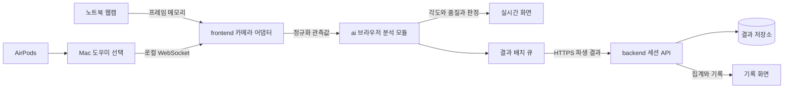

# 브라우저 분석과 결과 저장 구조

영상과 센서 원본은 로컬에서 처리하고, 백엔드는 소유자별 파생 결과와 집계를 관리합니다. 실행 스택은 ADR-0002에 반영했고 운영 DB·호스팅은 DEC-008에서 확정합니다.

## 책임과 의존 방향

| 경계 | 입력 | 출력 | 금지 |
|---|---|---|---|
| frontend 장치 어댑터 | 프레임, helper 메시지 | 시간·좌표·단위를 정규화한 관측값 | 프레임 업로드, UI에서 판정식 복제 |
| ai 분석 모듈 | 관측값, 로컬 보정값, 불변 정책 | 창별 파생 각도·판정·품질, 알림 후보 | 네트워크·DOM·DB 직접 접근 |
| frontend 수명주기·알림 | 분석 결과, 사용자 입력 | 상태 화면, 알림 실행 결과, 저장 배치 | 알림 요청을 실제 전달 성공으로 기록 |
| backend | 허용된 결과·이벤트 | 저장 승인, 소유자별 조회·집계·삭제 | 원본 센서 처리, 클라이언트 통계 무조건 신뢰 |
| Mac 도우미 | OS 모션 API | 시각·축 정의가 있는 머리 움직임 | 카메라 접근, 클라우드 전송 |

`frontend → ai` 의존을 허용합니다. `ai → frontend/backend` 의존은 만들지 않습니다. 공유 계약은 [API](docs/api/README.md)와 정책 버전으로 연결합니다. 파일 배치와 빌드 연결은 기술 선택 후 확정합니다.

## 신뢰 경계

- 브라우저 입력은 서버에서 다시 검증합니다. 집계는 서버의 승인된 창과 이벤트로 재계산합니다.
- 세션 소유자는 인증 문맥에서 정합니다. 요청 본문의 사용자 ID로 소유권을 정하지 않습니다.
- 도우미는 루프백에만 바인딩하며 허용 Origin·페어링 인증이 필요합니다. HTTPS 웹과 로컬 연결의 실제 허용 여부는 DEC-003 검증 대상입니다.
- 로컬 보정 기준 좌표와 원시 IMU는 세션 종료·재보정 때 폐기합니다. 서버에는 적용 정책 ID와 허용된 결과 메타데이터를 보관합니다.

## 시간과 저장

분석에는 브라우저 단조 시계를 사용합니다. 다른 프로세스의 단조 시계는 [도우미 계약](docs/api/airpods-websocket.md)에 따라 정렬합니다. 서버 저장 시각은 UTC이며, 창별 상대 시각은 세션 시작 기준 밀리초입니다. UI와 기간 집계에는 선택한 IANA 시간대를 적용합니다.

[분석 파이프라인](docs/measurement/signal-pipeline.md), [데이터 모델](docs/data/model.md), [정책 결정 기록](docs/decisions/adr-0001-browser-analysis.md)을 함께 참조합니다.

## 1차 MVP 실행 구조

사용자 지정 스택은 [ADR-0002](docs/decisions/adr-0002-first-mvp-stack.md)에 기록했습니다.
frontend와 ai는 npm workspace이며 backend는 Flask입니다. 최초 실행 저장소는 SQLite이고 DynamoDB 어댑터는 실환경 검증 대기입니다.
모든 저장 세션은 data_source=demo입니다. [현재 범위](docs/development/mvp-status.md)는 실제 센서 출시 범위와 구분합니다.
