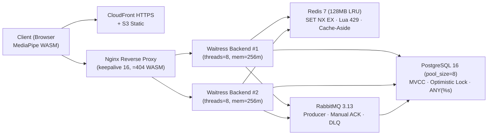

# [Day 20] 종합설계 성과발표회 포스터 & 발표용 6대 인프라·DB 트러블슈팅 정량 지표 요약

## 1. 아키텍처 진화 요약 (SQLite 단일 프로세스 → 고가용성 다중 컨테이너 & AWS 클라우드)

---

## 2. 포스터 핵심 표: 6대 병목 해결 `Before vs After` 정량 비교

| 번호 | 트러블슈팅 영역 | 기존 문제 (Before) | 해결 아키텍처 및 핵심 설정값 (After) | 정량 개선 결과 (검증 수치) |
| :--- | :--- | :--- | :--- | :--- |
| **① DB 쿼리 & 인덱스** | 통계 API 세션·샘플 조회 (`N+1` 문제) | `body TEXT` 통짜 저장 + 세션 $N$개 조회 시 `for`문으로 $3N$회 쿼리 실행 (5개 세션 기준 `15 SELECT`) | 검색 컬럼 6종 정규화 분리 + 복합 부분 인덱스(`idx_sessions_owner_started`) + `load_many` `ANY(%s)` 배치 조회 | 세션 수와 무관하게 고정 **`3 SELECT`** (**쿼리 수 80%+ 감소**) |
| **② DB 연결 & 동시성** | 매 요청 연결 생성 및 동시 따닥 클릭 충돌 | 요청마다 `connect()/close()` 반복 + 파일 단위 잠금(SQLite `BEGIN IMMEDIATE`) | `Waitress threads(8)`에 맞춘 **`pool_size=8` 커넥션 풀** + `ON CONFLICT DO NOTHING` + `revision` 낙관적 락 + `REPEATABLE READ` | 연속 5회 쿼리 시 연결 생성 **5회 → 1회** (재사용률 80%+), 동시 중복 생성 **0건** |
| **③ 다중 서버 동시성 & 도배 방어** | `replicas: 2` 확장 시 로컬 메모리 불일치 & `GET→INCR` 경쟁 조건 | 서버별 로컬 메모리에 상태 저장 시 다른 컨테이너로 들어온 중복/폭주 요청 차단 불가 | 공용 Redis **`SET NX EX 10` 분산 선점 락** + **`INCR → EXPIRE` 단일 Lua 스크립트(`EVAL`)** 원자적 Rate Limiter(`429`) | 다중 WAS 동시 따닥 요청 **100% 단일 선점**, 한도 초과 폭주 요청 **즉시 `429` 차단** |
| **④ 실시간 통계 캐시 & 장애 우회** | 측정 중 반복 통계 조회(`include_active=true`) 부하 및 캐시 SPOF | 매 조회마다 DB 전체 재집계, 캐시 서버 장애 시 `500` 에러 위험 | **Redis `Cache-Aside`(5s TTL)** + 변경 시 **`Write-Invalidation`** + Redis 장애 시 원본 DB로 우회하는 **`Circuit Fallback`** | 캐시 히트 시 **DB 쿼리 0회**, Redis 다운 시에도 **API 에러율 0% (`200 OK` 유지)** |
| **⑤ 비동기 배치 & 무손실 큐** | 30초 주기 `samples:batch` 동시 유입 시 동기 DB 적재 지연 | DB 저장 완료까지 HTTP 요청 대기, 워커 중단 시 배치 유실 위험 | **RabbitMQ Producer(`persistent=True`) + 동기 `Fallback`** + Consumer **`Manual ACK`(`prefetch=1`)** + 3회 실패 시 **`DLQ` 격리 후 `Replay`** | 브로커/DB 재시작 장애 주입 시에도 **측정 배치 데이터 유실 0건** |
| **⑥ 저사양 클라우드(`t4g.small`) 메모리·배포** | `2GB RAM` 환경 OOM·스왑 쓰래싱 및 배포 직후 Cold Start | 무제한 컨테이너 메모리 및 기본 `swappiness=60`으로 인한 디스크 스왑 지연, 첫 요청 DB 연결 지연 | 컨테이너별 **`mem_limit` 총합 `1,376MB` 배분(OS 여유 `672MB` 확보)** + **`2GB Swap` & `vm.swappiness=10`** + 기동 시 **커넥션 풀 `Warm-up`** | 배포 직후 첫 요청 전 **풀 예열 완료(`pool=1`)**, `2GB` 한도 내 **OOM 0건** |
