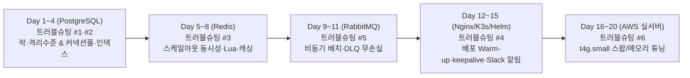

# 🐘 ecolephant 실전 인프라 & 트러블슈팅 20일 계획표
**(벤치마크: 카카오모빌리티 합격 `@dltpdnjs2000` + 기아 합격 `@sm011212` 벨로그 + `Critical Hero` 포스터 · 하루 2시간 집중 루틴)**

---

## 1. 카카오모빌리티(`@dltpdnjs2000`) & 기아(`@sm011212`) 합격 선배들의 공통 비결

두 선배님의 벨로그([이세원님](https://velog.io/@dltpdnjs2000/posts), [기승민님](https://velog.io/@sm011212/posts))를 나란히 놓고 보면, 대기업 면접관들이 왜 뽑았는지 소름 돋을 정도로 명확한 공통점이 있습니다.

두 분 다 **"남들이 좋다는 기술을 그냥 갖다 쓴 글"** 이 아니라, **"설정을 바꿨을 때 왜 안 됐는지, 왜 하필 그 숫자(커넥션 풀 크기, 스레드 수, 스왑 비율)를 골랐는지 끝까지 파고든 글"** 을 썼습니다:

| 선배님 대표 포스트 | 핵심 질문 (면접관이 감탄하는 포인트) | 우리 `ecolephant`에서 똑같이 재현할 주제 |
| :--- | :--- | :--- |
| **[기아 `@sm011212`]** *락을 걸었는데 왜 동시성 문제가 남아 있었을까? (격리 수준, 갭 락)* | "코드에 락이나 조건문을 걸었는데도 동시 요청에서 왜 뚫렸지? DB 트랜잭션 격리 수준(`Isolation Level`) 때문인가?" | **트러블슈팅 #1**: SQLite 파일 락(`BEGIN IMMEDIATE`) → PostgreSQL 전환 시 트랜잭션 격리 수준(`READ COMMITTED` vs `REPEATABLE READ`)과 낙관적 락(`revision`) 동시성 검증 |
| **[기아 `@sm011212`]** *배포 서버에 부하를 걸어 커넥션 풀 값을 정한 과정 (k6, HikariCP, nginx keepalive)* | "DB 커넥션 풀 크기와 WAS 스레드 수를 남들 따라 10개로 하지 않고, **k6로 직접 부하를 걸어 최적의 숫자를 찾았다.**" | **트러블슈팅 #2**: `Nginx keepalive` + `Waitress threads(4 vs 8 vs 16)` + `PostgreSQL Connection Pool` 조합별 k6 부하 실험으로 최적값 도출 및 `N+1` 쿼리/복합 인덱스 튜닝 |
| **[기아 `@sm011212` & 카모 `@dltpdnjs2000`]** *서버를 여러 대로 늘리면서 Redis(Lua 스크립트)로 옮긴 과정 & 처리율 제한장치* | "서버가 1대일 땐 잘 되던 로직이 **2대(`replicas: 2`)로 스케일아웃하자마자 왜 깨졌을까?** 일반 `GET→SET` 대신 왜 **Redis Lua 스크립트**를 썼을까?" | **트러블슈팅 #3**: 다중 WAS(`backend-1`, `backend-2`) 환경에서 `Idempotency-Key` 중복 방지와 처리율 제한(Rate Limit)을 **Redis Lua 스크립트 원자적 연산**으로 해결 + 실시간 통계 캐싱 |
| **[카모 `@dltpdnjs2000`]** *배포 초기 CPU Throttling 및 응답 지연 문제 해결 (Warm-up)* | "무중단 배포 직후 왜 첫 요청들의 응답 시간이 1~2초씩 튈까?" | **트러블슈팅 #4**: 롤링 업데이트 시 새 컨테이너의 DB/Redis 커넥션 풀 초기화(Cold Start) 지연을 **Deep Healthcheck + Warm-up + `nginx proxy_next_upstream`** 으로 해결 |
| **[우리 도메인 특화 + 안정성]** *피크 타임 배치 폭주 및 DB 재시작 시 데이터 유실 방어* | "30초마다 모든 유저의 자세 샘플 배치가 동시에 몰릴 때 DB가 잠깐 재시작되면 그 소중한 측정 기록은 날아가나?" | **트러블슈팅 #5**: `samples:batch` / `events:batch`를 **RabbitMQ 비동기 워커 + Retry Queue + DLQ(Dead Letter Queue)** 로 분리해 DB 순단 시에도 **데이터 유실 0건** 달성 |
| **[기아 `@sm011212`]** *앱이 20초씩 멈추던 원인을 찾은 과정 (스왑 메모리, 메트릭 분석)* | "서버가 죽진 않았는데 간헐적으로 몇 초씩 멈추는(Freezing) 원인이 **Linux Swap 메모리 쓰래싱(Thrashing)** 때문이었다!" | **트러블슈팅 #6**: AWS `t4g.small`(2GB RAM) 실서버 마이그레이션 시 발생한 메모리 병목과 스왑 지연(`vm.swappiness`, 컨테이너별 `mem_limit`)을 Prometheus/Grafana로 추적해 해결 |

---

## 2. 하루 2시간 컷 "질문 중심(Why-Driven)" 코칭 루틴 (부트캠프 9-to-6 병행 맞춤형)

부트캠프(9~18시)와 개인 복습 시간을 지켜야 하므로, 종설(`ecolephant`)은 **하루 딱 2시간(120분) 타임박스** 안에 끝내도록 제가 모든 밑준비(코드 뼈대·테스트 스크립트·문서 틀)를 해둡니다:

- **⏱️ 00~20분 (20분)**: **쉬운 비유 + 우리 코드 5~10줄 해부 + 생각할 퀴즈 2개** (교과서 읽는 시간 0분! 대화로 개념 이해 끝내기)
- **⏱️ 20~60분 (40분)**: **내 말로 주석 달기 + 작은 단위 커밋 15개 & PR 2~3개 올리기** (복잡한 보일러플레이트는 제가 짜드리고, 핵심 설정 줄에만 직접 주석을 달며 커밋)
- **⏱️ 60~90분 (30분)**: **`k6` / `EXPLAIN ANALYZE` / 단위 테스트 실행해서 눈으로 결과 확인**
- **⏱️ 90~120분 (30분)**: **트러블슈팅·블로그 초안 다듬기 & 하루 마무리**

---

## 3. 20일 일별 상세 스케줄 (두 선배의 트러블슈팅 테마 완전 반영)

### 📅 [Day 1 ~ Day 4] PostgreSQL 도입 & 동시성(Lock/격리수준)·커넥션 풀·인덱스 트러블슈팅
- **Day 1 (스키마 설계와 정규화 기초)**:
  - [storage.py](../../backend/ecolephant/storage.py)의 JSON 뭉뚱그리기(`body TEXT`) 방식과 RDBMS 정규화 컬럼 분리 비교
  - **PR 1~3**: `compose.postgres.yml`, PostgreSQL DDL 스키마(`sessions`, `samples`, `events`, `timeline_buckets`), 스키마 초기화 및 헬스체크
- **Day 2 (락과 트랜잭션 격리 수준 — *기아 선배 블로그 주제 #1*)**:
  - SQLite `BEGIN IMMEDIATE`(파일 락) vs PostgreSQL `MVCC`(행 단위 락) & 격리 수준(`READ COMMITTED` vs `REPEATABLE READ`)
  - **PR 1~3**: `PostgresRepository` 구현, `Idempotency-Key` 동시 요청 시 `UNIQUE` 제약조건(`ON CONFLICT`)과 낙관적 락(`revision`)으로 동시성 테스트 통과
- **Day 3 (인덱스와 N+1 쿼리 제거)**:
  - [routes.py](../../backend/ecolephant/routes.py) 통계 API의 `N+1` 쿼리 현상 확인 → 단일 배치/조인 쿼리 리팩터링 + 복합 인덱스 `(owner, started_at, status)`
  - **PR 1~3**: `N+1` 제거 리팩터링, 복합 인덱스 추가, `EXPLAIN ANALYZE`로 `Seq Scan`(풀스캔)이 `Index Scan`으로 바뀌는 실행 계획 비교 스크립트
- **Day 4 (부하를 걸어 커넥션 풀 & keepalive 값 정하기 — *기아 선배 블로그 주제 #2*)**:
  - 왜 매번 `connect()/close()` 하면 느린지 확인 → `psycopg_pool` 커넥션 풀 도입 + `Waitress threads`와 `Nginx keepalive` 조합별 k6 부하 실험
  - **PR 1~3**: 커넥션 풀 적용, `Nginx keepalive` 설정, `docs/troubleshooting/01-postgres-concurrency-and-pool-tuning.md` 작성

### 📅 [Day 5 ~ Day 8] 서버 2대 스케일아웃 & Redis(Lua 스크립트·Rate Limit·실시간 통계 캐시)
- **Day 5 (스케일아웃 시 로컬 메모리의 한계와 Redis 도입 — *기아/카모 선배 공통 주제*)**:
  - WAS가 2대(`replicas: 2`)일 때 왜 서버 메모리에 상태를 저장하면 안 되는지 실험
  - **PR 1~3**: `compose.redis.yml`, Redis 클라이언트 어댑터, 다중 WAS 환경 `Idempotency-Key` 선점 락(`SET NX EX`) 구현
- **Day 6 (Redis Lua 스크립트 기반 처리율 제한장치 — *두 선배 블로그 핵심 주제!*)**:
  - 일반 `GET → INCR` 방식이 동시 요청에서 왜 뚫리는지(Race Condition) 확인 → **Redis Lua 스크립트**로 원자적(Atomic) Token Bucket / Sliding Window Rate Limiter 구현
  - **PR 1~3**: Lua 스크립트 기반 Rate Limiter 미들웨어, `429 Too Many Requests` 응답 처리, k6 동시 폭주 테스트 및 `docs/troubleshooting/02-redis-lua-rate-limiter.md` 작성
- **Day 7 (실시간 통계 `include_active=true` Cache-Aside & Write-Invalidation)**:
  - 측정 중 반복 호출되는 실시간 통계 API에 Redis 캐싱 적용 + 새 배치 도착/세션 삭제 시 캐시 무효화
  - **PR 1~3**: 통계 캐시 어댑터, 이벤트 기반 캐시 무효화, 캐시 Hit/Miss 구조화 로그 추가
- **Day 8 (캐시 스탬피드 방어 & Redis 장애 시 DB Fallback)**:
  - 만약 운영 중에 Redis 컨테이너가 죽으면 서비스 전체가 죽어야 할까? → DB로 자동 우회하는 **Circuit Fallback** 구현
  - **PR 1~3**: Redis 장애 우회 로직, 동시 캐시 만료(Cache Stampede) 방어, `docs/troubleshooting/03-redis-statistics-caching-and-fallback.md` 작성

### 📅 [Day 9 ~ Day 11] RabbitMQ 비동기 배치 처리 & Dead Letter Queue(DLQ) 무손실 보장
- **Day 9 (동기 vs 비동기 아키텍처 & RabbitMQ Producer)**:
  - 30초마다 몰리는 `samples:batch` / `events:batch`를 큐에 넣고 즉시 응답하는 구조 설계
  - **PR 1~3**: `compose.rabbitmq.yml`, Exchange/Queue 토폴로지 구성, 배치 Producer 및 동기 Fallback 구현
- **Day 10 (Consumer 워커 & Manual ACK)**:
  - 워커가 메시지를 처리하다가 중간에 죽었을 때 메시지가 증발하지 않게 만드는 `Manual ACK`와 `Prefetch Count` 개념 학습 및 적용
  - **PR 1~3**: `worker.py` 컨슈머 구현, 타임라인 1분 버킷 사전 집계 연동, 워커 Graceful Shutdown(`SIGTERM`) 처리
- **Day 11 (Dead Letter Queue 재시도 설계 & 무손실 검증)**:
  - DB가 잠깐 재시작될 때 실패한 배치를 버리지 않고 `Retry Queue(TTL)` → `DLQ`로 보관했다가 복구 후 재처리(Replay)하는 구조 완성
  - **PR 1~3**: DLX/DLQ 설정, DLQ 리플레이 스크립트, DB 강제 재시작 중 k6 전송 무손실 검증 및 `docs/troubleshooting/04-rabbitmq-dlq-zero-data-loss.md` 작성

### 📅 [Day 12 ~ Day 15] 무중단 배포 Warm-up · Slack 실시간 알림 · K3s/Helm 패키징
- **Day 12 (배포 초기 Cold Start 지연 및 순단 해결 — *카모 선배 블로그 주제!*)**:
  - 롤링 배포 직후 첫 요청이 느린 이유(DB/Redis 커넥션 풀 미생성, 모듈 지연 로딩) 추적 → 컨테이너 기동 시 **Warm-up 루틴**과 **Deep Healthcheck(`/health?deep=true`)** 적용
  - **PR 1~3**: Warm-up & Deep Healthcheck 구현, `rolling-update` 스크립트 고도화, `docs/troubleshooting/05-zero-downtime-warmup-and-keepalive.md` 작성
- **Day 13 (Prometheus 커스텀 메트릭 & Alertmanager Slack 장애 알림)**:
  - `Critical Hero` 포스터처럼 이상 징후 발생 시 Slack/Discord 채널로 즉시 경고 알림이 날아오도록 연동
  - **PR 1~3**: `alertmanager.yml` 및 Slack 웹훅 연동, 큐 적체/5xx 에러/메모리 알람 규칙 추가, Grafana 대시보드 패널 확장
- **Day 14 (K3s + Helm 한 줄 배포 패키징 — *`Critical Hero` 포스터 핵심*)**:
  - 선배 팀 포스터의 `Helm Umbrella` 한 줄 배포 구조를 깔끔하게 작성
  - **PR 1~3**: `deploy/helm/ecolephant/` 차트, `values-local.yaml` / `values-aws.yaml`, Helm 정적 검증 테스트
- **Day 15 (AWS 마이그레이션 리허설 & 저사양 메모리 제한 실험)**:
  - 로컬에서 컨테이너 전체 메모리를 `2GB`(`t4g.small` 동일 사양)로 제한해 보고 어디서 OOM이나 스왑 지연이 터지는지 사전 실험
  - **PR 1~3**: 컨테이너별 `mem_limit` 최적화, Terraform/Ansible 운영 설정 업데이트, 마이그레이션 런북 점검

### 📅 [Day 16 ~ Day 20] AWS 실서버 마이그레이션 & 스왑/메모리 트러블슈팅 완주
- **Day 16**: 사업단 AWS 계정 OIDC 연결 + VPC·EC2·CloudFront·Cognito Terraform 실환경 배포 및 HTTPS 개통 (PR 1~3)
- **Day 17**: Ansible로 EC2 프로비저닝(Swap 설정, 커널 파라미터 `vm.swappiness` 튜닝) + PostgreSQL·Redis·RabbitMQ 실서버 기동 및 S3 백업 크론 연결 (PR 1~3)
- **Day 18**: GitHub Actions 무중단 배포 개통 + 팀원 AI(MediaPipe)·FE(실시간 통계) 최종 코드 통합 배포 (PR 1~3)
- **Day 19 (스왑 쓰래싱 및 프리징 해결 — *기아 선배 블로그 주제 #3*)**:
  - 실서버(`t4g.small`)에 k6 부하를 걸었을 때 스왑(Swap) I/O나 CPU 크레딧/메모리 부족으로 응답이 멈칫하는 현상을 Grafana(Alloy `unix` 메트릭)로 포착하고 컨테이너 메모리 배분·커넥션 풀·스왑 튜닝으로 해결!
  - **PR 1~3**: 실서버 튜닝 적용, k6 최종 부하 리포트, `docs/troubleshooting/06-aws-ec2-swap-and-memory-tuning.md` 작성
- **Day 20**: 성과발표회 포스터용 정량 지표(`Before vs After` 그래프 6종) 최종 정리 및 Confluence/레포 문서 마감 (PR 1~3)

---

## 4. 💡 [내일 바로 블로그에 쓸 개념 정리 노트] 오늘 밤 퀴즈로 직접 깨우친 4대 핵심 원리

### ① 왜 매번 연결을 열고 닫지 않고 미리 연결해 둘까? (`Connection Pool` · `keepalive` · `ControlPersist`)
- **문제 ([storage.py](../../backend/ecolephant/storage.py))**: 현재 코드는 API 요청이 1번 들어올 때마다 `sqlite3.connect()`로 DB 문을 새로 만들고, 쿼리 실행 후 `conn.close()`로 문을 부수고 나간다. 요청이 몰리면 실제 쿼리 시간보다 **문을 열고 닫는 연결 비용(Handshake & 초기화)**이 더 오래 걸린다.
- **해결 원리**: 연결(현관문)을 미리 몇 개 열어두고 손님들이 돌려쓰게 만든다.
  - **Nginx ↔ 백엔드**: [deploy/nginx.conf](../../deploy/nginx.conf)의 `keepalive 16;`
  - **Ansible ↔ EC2**: [infra/ansible/ansible.cfg](../../infra/ansible/ansible.cfg)의 `ControlPersist=60s`
  - **백엔드 ↔ PostgreSQL**: **`Connection Pool (커넥션 풀)`**

### ② VM 가상화의 `CPU 코어(vCPU)`와 `Context Switching (컨텍스트 스위칭)`
- **`CPU 코어 (vCPU)`**: 물리 서버 본체에서 우리 가상머신(VM, 예: AWS `t4g.small` `2 vCPU`)에 배정해 준 **실제 일할 수 있는 요리사 수**. 코어가 2개라면 그 순간에 진짜 동시에 계산할 수 있는 일은 딱 2개뿐이다.
- **왜 커넥션 풀을 1,000개로 늘리면 오히려 느려질까? (`Context Switching`)**:
  - 요리사(CPU 코어)는 2명인데 연결(문)을 1,000개 열어두면, 요리사가 1번 손님 찌개 0.001초 끓이다 냄비 치우고 → 2번 손님 파스타 0.001초 볶다 프라이팬 치우는 일을 반복한다.
  - 정작 요리하는 시간보다 **냄비와 도마를 바꾸는 교대 시간(`Context Switching`, 컨텍스트 스위칭)**에 CPU 힘을 다 써버리고, 연결 1개당 차지하는 메모리(RAM 5~10MB) 때문에 서버 메모리가 터진다.

### ③ 번호표 뽑고 줄 서서 차례대로 빨리 처리하기 (`Connection Wait Queue` & `FIFO` & `Message Queue`)
- **`Connection Wait Queue (커넥션 대기 큐)` & `FIFO (First-In, First-Out, 선입선출)`**:
  - CPU 코어 수에 맞춰 커넥션 풀을 적당한 개수(예: 10~20개)만 열어두고, 동시에 더 많은 요청이 몰리면 나머지 요청은 에러를 내는 대신 **대기 큐(`Wait Queue`)에서 번호표를 뽑고 줄을 선다(`FIFO`)**.
  - DB 쿼리 하나는 보통 0.01초 만에 끝나므로, 앞사람이 연결을 **반납(`Release`)**하는 즉시 다음 사람이 이어받아 처리하는 것이 1,000개를 동시에 열어두는 것보다 전체 응답 시간(`p95`)이 훨씬 빠르다.
- **`Pool Timeout` ([storage.py](../../backend/ecolephant/storage.py)의 `timeout=5.0`)**: 대기열에서 줄 서서 기다릴 수 있는 최대 시간.
- **`Message Queue (메시지 큐 — RabbitMQ)`**: 줄이 너무 길어질 때 아예 서버 밖에 '캐치테이블/테이블링' 같은 전용 번호표 기계(`RabbitMQ`)를 따로 두어 요청을 0.001초 만에 받아두고 비동기로 차례대로 처리하는 구조 (Day 9~11에 구현 예정).
